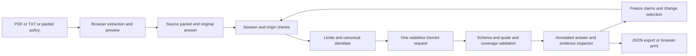

# Second Opinion architecture

The application has one Next.js App Router server and a React client. Documents start in memory; explicit review-file export/restore and optional account storage are now implemented. Source extraction, editor state, report display, a bounded 20-report cache, JSON downloads, and print rendering live in the browser. Server routes handle access, input validation, Gemini invocation, and report validation.

## Pages and client state

The App Router serves `/`, `/workspace`, `/examples`, `/lab`, `/methodology`, and `/present`. A root client `WorkspaceProvider` preserves the source packet, answer, reports, selection, setup step, and reviewer annotations during client navigation. It does not use local/session storage or report-sharing URLs. Refresh and reset clear unsaved memory. A restorable JSON archive validates sources, quotations, spans, fixed comparisons, report links and annotations; it strips baseline tokens. Optional account saves use Supabase Postgres with immutable versions, ownership RLS, optimistic concurrency and explicit deletion. The bounded request cache belongs to the mounted workbench and is cleared on leaving that page; completed reports remain in the provider.

`SetupFlow` handles the pre-report workspace: policy selection, answer input, and an explicit summary/check step. The example entry can seed this flow without creating a report until the user requests the example results. Own-document entry starts empty. The UI checks health before enabling a live submission and explains unavailable configuration. The server remains authoritative for configuration, access, input validation, and billing guards. A result guide selects the first non-supported or unresolved statement without altering the report.

Examples load known synthetic source packets and authored reports, with confirmation before replacing an existing workspace. The evidence lab uses four authored challenges and component-local exercise state. Neither feature calls the audit API. The presentation route reads the active baseline or comparison from the provider and has an explicit empty state for direct visits without a report.

Review annotations are keyed by report ID and claim ID. A checkbox records that a human reviewed the claim; it does not change the semantic verdict. A plain-text review brief includes the report's findings and quotes plus separately labelled reviewer notes, excluding the internal baseline signature. JSON/print exports retain their existing report-only behavior. Annotations remain report-scoped across revisions; loading a different example or clearing resets them. Saving a complete review includes claim notes, edited rule interpretations, historical reports and revision metadata.

## Interfaces

`POST /api/session` accepts `{code}` and issues a signed eight-hour `HttpOnly`, `SameSite=Strict` cookie (`Secure` in production). `DELETE /api/session` expires it. Audit access is checked on the server. Stateless logout removes the browser cookie; it does not revoke a copied token before expiry. Rotate the signing secret to revoke all sessions.

`GET /api/health` returns configuration readiness, operator-enabled state, authentication state, and the configured model. It does not call Gemini or expose keys.

`POST /api/audit` accepts mode (`audit` or `compare`), original answer, optional context, complete source inputs with page text, selected source IDs, and fixed claims plus a signed baseline token for comparisons. The server rebuilds content identities, validates the token for comparisons, and calls Gemini once. With no selected comparison sources, it returns an explicit source-insufficient assessment without invoking a model.

Reports contain canonical claims, semantic verdicts or null for unresolved findings, issue tags, explanations, evidence strengths, validated references, answer spans, sources and hashes, selected IDs, completion warnings, timestamps, model/prompt version, latency, and available numeric usage. The baseline signature is used internally and excluded from downloaded reports.

Errors have `{error:{code,message,requestId}}`. Input, body limit, access, origin, configuration, disabled service, quota, timeout, model unavailability, invalid output, and stale baseline are distinct. Responses are not cached by the HTTP layer.

## Integrity boundaries

Source IDs derive from SHA-256 hashes of normalized page content. Pages are preserved. Paragraph blocks receive stable source/page/block identities. Answer sentence spans come from the original string. The model returns exact quotations rather than trusted character offsets; offsets are computed by matching supplied text. A repeated quotation identifies a whole block rather than pretending to be uniquely located.

Supported and contradicted findings require valid evidence of the corresponding relation. Conflicting-strength findings require both sides. Unknown blocks, excluded sources, fabricated quotes, ambiguous answer offsets, missing sentences, duplicate claim IDs, and modified comparison propositions cannot silently pass as verified findings.

Sentence accounting is a coverage guard, not proof of complete atomic extraction. A model can miss one proposition inside a covered sentence. The human-labelled evaluation denominator is necessary to detect this.

## Security and cost controls

Origin allowlisting, bounded streamed request bodies, random secrets, signed session/baseline tokens, escaped rendering, a nonce-based production Content Security Policy, disabled framing, and metadata-only logs protect the implemented boundary. Uploaded text is treated as untrusted evidence, and Gemini receives no tools or external fetching capability.

The in-process limiter allows 10 login attempts per minute per observed IP and 3 audits per minute per session per instance. It is best effort on serverless hosting, not a distributed/global abuse guarantee. The browser permits one active audit, aborts stale results, and caches identical completed requests during the session. Gemini requests disable retries and time out after 45 seconds; the route has a 60-second limit.

Cost protection depends on a verified unpaid Gemini project and unchanged Vercel Hobby plan. The app cannot verify an account's billing state from an API key. `FREE_TIER_CONFIRMED` requires an operator's affirmative setup check. No automatic model or provider fallback exists.

## Optional account and persistence path

`AUTH_MODE=supabase` switches authorization to individually authenticated provider sessions. Every protected request checks active `auth.sessions` and user bans through a narrowly granted RPC. Data RPCs use the user token; only private rate-limit reservations use the server secret key. Account outages fail closed. No refresh token is stored; expiry requires sign-in again.

`POST /api/workspaces` supports explicit list/save/load/delete operations. Files are limited to 2 MiB; cloud reviews have immutable versions, owner checks, stale-write protection, and database storage caps. Restored results are labelled historical and require a new baseline before live comparison. No automatic save occurs.

Source files: `src/lib/workspace-archive.ts`, `src/lib/server/accounts.ts`, `supabase/migrations/`. Setup, privacy, quotas and unverified hosted gates: [accounts and storage](ACCOUNTS-AND-STORAGE.md). SQL permission tests execute actual PostgreSQL in PGlite with simulated gateway claims, not a real Supabase network deployment.

## Production boundary

The default configuration remains a shared-code pilot. The optional account path implements per-user saved records, session revocation and database-backed limits, but its hosted deployment and actual concurrent connections are unverified. It does not provide SSO, organizational roles, or a regulated decision service. Commercial/confidential use requires a separate design review covering authentication, provider terms, retention, incident handling, load, and adversarial evaluation. These are explicit limitations, not capabilities implied by a successful build.
