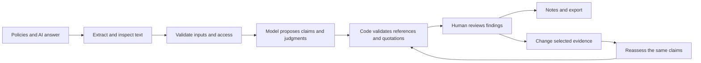

**My recommendation is to build Second Opinion around one clear promise: “Before you send an AI answer, check every important statement against your actual policies.”**

I reviewed the implementation, its recorded test results, and research on factuality checking, policy reasoning, citations, and human–AI interaction. The strongest next step is to improve **reliability, clarity, and the ability to fix a flagged answer**.

The roadmap below has three phases: a convincing hackathon release, a substantially smarter reviewer, and a dependable product for real users.

**What the project does.** Second Opinion is a business-policy review application. A user supplies policy documents and an AI-generated answer. The application identifies individual claims, checks them against the selected documents, and shows the evidence behind each judgment.

The best initial audience is customer-support staff and people reviewing support answers. Returns, refunds, subscriptions, warranties, and service policies give us concrete problems with understandable consequences.

For example, suppose a fictional policy says:

> Premium members have 30 days to return an item. Return shipping is free. No refund-processing timeline is specified.

An AI answer says:

> You have 30 days to return it, shipping is free, and your refund will arrive within 48 hours.

Our report should separate the answer:

| Statement | Expected judgment | Reason |
|---|---|---|
| Premium members have 30 days to return an item | Supported | The policy explicitly permits it |
| Premium members receive free return shipping | Supported | The policy explicitly provides it |
| The refund will arrive within 48 hours | Insufficient evidence | The supplied policy provides no timeline |

The distinction in the final row matters: **missing support does not establish that a claim is false.**

The product’s scope is the supplied policy packet. It cannot establish whether a document is authentic, whether an omitted policy changes the answer, or whether a statement is universally true.

**What we already have.** The current application is more than a landing-page prototype, but live AI quality and a hosted release remain unverified.

| Area | Implemented today |
|---|---|
| Landing page | Cinematic design, interactive evidence story, clear example and own-document entry |
| Guided setup | Add policies → add answer → check and review |
| Inputs | Selectable-text PDF, TXT, and pasted policies |
| Review | Individual claims, four judgments, explanations, exact quotations, page references |
| Evidence comparison | Remove selected sources while keeping the original answer and claims fixed |
| Human review | Notes, reviewed markers, progress tracking |
| Outputs | JSON report, printable report, review brief |
| Supporting pages | Example library, evidence exercises, methodology, presentation mode |
| Reliability controls | Input limits, output validation, cancellation, explicit retries, preserved drafts |
| Security controls | Signed sessions, signed comparison baseline, origin checks, restricted rendering |
| Recorded verification | Production build, 48 deterministic tests, 19 browser tests |

The application currently has six routes: `/`, `/workspace`, `/examples`, `/lab`, `/methodology`, and `/present`.

Documents and reports stay in application memory. Refreshing clears them. Example reports are explicitly authored examples; they do not demonstrate live model accuracy. These boundaries are documented in the [release record](C:/Users/loelb/OneDrive/Desktop/kick/docs/RELEASE.md).

**How the technical workflow operates.** The main stack is Next.js, React, TypeScript, PDF.js, Zod, and a server-side Gemini adapter.

The current live path uses one model request per audit. It sends the selected source blocks directly; there is no vector database or large-document retrieval service.

That is a reasonable architecture for the present limits: five documents, 20 total pages, 60,000 source characters, and 20 claims. Introducing retrieval now would create another way to miss an exception before we have measured the existing system.

There are two different kinds of checking:

- **Code checks:** whether a quotation exists, whether a source is selected, whether claim identities changed, and whether the response follows the schema.
- **Model judgments:** whether a passage actually supports a claim, whether an exception applies, and whether two rules conflict.

A real quotation can still be interpreted incorrectly. Our interface and evaluation must preserve that distinction.

**What the research tells us.** These are the most useful findings for this project. The recommendations are my proposed applications of the research; the papers do not establish our product’s accuracy.

| Research | Relevant finding | Consequence for Second Opinion |
|---|---|---|
| [FActScore — EMNLP 2023](https://aclanthology.org/2023.emnlp-main.741/) | Long answers mix supported and unsupported atomic facts | Keep the individual-claim view; avoid hiding problems behind one overall score |
| [ALCE — EMNLP 2023](https://aclanthology.org/2023.emnlp-main.398/) | Answer correctness and citation quality require separate evaluation | Measure evidence relevance and completeness, alongside quotation existence |
| [RAGTruth — ACL 2024](https://aclanthology.org/2024.acl-long.585/) | Human annotations identify unsupported and contradictory content at fine granularity | Evaluate missed claims and incorrect highlighting, not just returned verdicts |
| [Decomposition Dilemmas — NAACL 2025](https://aclanthology.org/2025.naacl-long.320/) | Splitting text into claims can introduce errors and reduce verification quality | Test whether extraction preserves conditions, quantities, and meaning |
| [InteGround — EMNLP Findings 2025](https://aclanthology.org/2025.findings-emnlp.732/) | Models can use internal knowledge to rationalize answers when evidence is incomplete | Add difficult missing-information cases and require explicit uncertainty |
| [RAGONITE — 2024 preprint](https://arxiv.org/html/2412.10571v1) | Evidence removal is affected by redundant sources and model variability | Test duplicate support and repeated identical inputs before interpreting changed verdicts |
| [Business as Rulesual — ACL 2026](https://aclanthology.org/2026.acl-long.1625/) | Business documents contain conditional branches and dependencies that benefit from structured treatment | Introduce inspectable policy rules with conditions and exceptions |
| [COMPASS — ACL 2026](https://aclanthology.org/2026.acl-long.2139/) | Its organizational-policy experiments expose weaknesses on adversarial prohibitions | Evaluate prohibited recommendations separately from ordinary factual mistakes |

This research supports our direction, but it also shows that “AI checking AI” is already an established field. Amazon Bedrock offers contextual grounding checks, and Ragas has claim-based faithfulness evaluation. Our differentiation must come from the review experience, policy handling, and measured usefulness. [Amazon documentation](https://docs.aws.amazon.com/bedrock/latest/userguide/guardrails-contextual-grounding-check.html), [Ragas documentation](https://docs.ragas.io/en/v0.3.9/concepts/metrics/available_metrics/faithfulness/).

**The strongest existing differentiator is the fixed-claim evidence comparison.** A reviewer can ask:

> “Would this statement still be supported if this policy were unavailable?”

We keep the answer and claims unchanged, reassess against the remaining documents, and show what changed.

That is useful for finding fragile support, missing exceptions, and conflicting documents. However, it measures the auditor’s sensitivity to supplied evidence. It does not reveal why the original answering model generated its answer. Research explicitly distinguishes supporting citations from faithful explanations of a model’s actual evidence use. [Correctness is not Faithfulness in RAG Attributions](https://arxiv.org/abs/2412.18004).

**Phase 1 should make the existing project demonstrably trustworthy and easy to use.** Treat this as the next focused hackathon work session. Account setup and recruiting testers may require additional elapsed time.

The priority order should be:

1. **Verify one complete live workflow.** Configure verified free model access, audit a synthetic answer, inspect quotations, remove a source, compare results, and export. Record failures and latency as well as successes.
2. **Run the existing evaluation suites.** We already have 12 development claims, 24 held-out claims, and eight paired scenarios. Use the development cases for changes and keep held-out cases separate.
3. **Fix misleading completion states.** I found a specific issue in the current [results guide](C:/Users/loelb/OneDrive/Desktop/kick/src/components/result-guide.tsx): its reassuring summary depends on returned findings. An incomplete report—or a report with no extracted claims—needs an explicit incomplete state before any positive summary.
4. **Test the starting experience with unfamiliar users.** Give five people the same task without explaining the interface. Observe where they hesitate.
5. **Prepare a short, repeatable demonstration.** Show one supported statement, one unsupported promise, one policy violation, and one evidence-removal comparison.

For the usability session, a useful initial target is that at least four of five participants finish the guided example without help and can explain why the refund timeline is unsupported. This is a formative target, not statistical proof of usability.

The UI should retain the landing design you liked. Inside the workbench, every screen should answer:

- What am I looking at?
- What needs my attention?
- What should I do next?

This follows research guidance to make capabilities clear, explain outcomes, and support correction when AI is wrong. [Microsoft’s Human–AI Interaction Guidelines](https://www.microsoft.com/en-us/research/publication/guidelines-for-human-ai-interaction/).

Phase 1 is complete when we have **an honest live demonstration, recorded evaluation results, and observed evidence that new users can finish the flow**.

**Phase 2 should improve the reasoning and help users resolve problems.** I would plan several iterations over roughly one to three weeks, depending on evaluation results. Four additions deserve priority.

**First, make policy conditions visible.** The current prompt already asks the model to preserve conditions and exceptions. The next improvement is to represent them explicitly.

For a return rule, show:

| Field | Example |
|---|---|
| Who it applies to | Premium members |
| Action | Return an item |
| Time limit | 30 days |
| Conditions | Unused item; proof of purchase |
| Exceptions | Clearance items excluded |
| Source | Premium policy, page 2 |
| Interpretation status | Needs reviewer confirmation |

The model can propose these fields, but the reviewer must be able to inspect the source and correct an extraction.

This would catch a common failure: an answer correctly quotes “30 days” while dropping “premium members only.” Where customer context is missing, ask the relevant question—such as membership status—only when it affects the judgment.

**Second, turn uncertainty into a useful next action.** “Insufficient evidence” should help the user continue.

For the 48-hour refund claim, the result could say:

> “The selected documents do not specify refund-processing time. Add a policy covering that topic, or remove the timing promise.”

For conflicting rules:

> “These passages specify different return windows. Confirm their scope or which document explicitly supersedes the other.”

The application should distinguish a missing rule, missing customer information, conflicting policies, and an extraction failure. Those situations need different responses.

**Third, add a proposed correction with a visible diff and a new check.** This closes the gap between detecting a problem and completing the user’s task.

The flow should be:

1. Select a flagged statement.
2. Request or manually write a correction.
3. Show the original and proposed wording.
4. Let the reviewer accept or edit it.
5. Audit the revised answer.
6. Preserve the original report beside the new one.

For example:

> Original: “Your refund will arrive within 48 hours.”  
> Proposed: “The supplied policies do not specify how long the refund will take.”

A generated correction remains a proposal. It must not quietly inherit the original report’s approval or comparison token, because changing the answer creates a new baseline.

**Fourth, add policy-version impact analysis.** This is a strong longer-term product feature:

> “This policy changed. Which previously reviewed answers need another look?”

Store explicit document versions and show a table of affected claims and changed judgments. A newer date alone must not imply authority; scope and supersession need to be explicit.

This requires extending the current architecture. Today’s signed comparison deliberately prevents changing document contents under the same baseline. Version comparison needs separate, linked audit records.

Phase 2 is complete when these features improve measured outcomes: fewer missed conditions, fewer incorrect approvals, and faster successful corrections.

**The evaluation must measure the whole review process.** Passing software tests is necessary, but it does not measure the model’s judgment.

I recommend expanding toward approximately 40 scenarios containing 160–200 manually labelled claims. That is a proposed evaluation size, not data we already possess.

Include:

- Straightforward support and contradiction.
- Missing information.
- Negation and explicit prohibitions.
- Numeric caps, dates, and equivalent units.
- Exceptions and overlapping scopes.
- Conflicting or superseded policies.
- Duplicate supporting documents.
- Instructions maliciously embedded in documents.
- Multiple claims inside one sentence.

Have two people independently label the difficult cases, record disagreements, and resolve them against the source text. Split by policy packet or scenario so near-duplicates do not leak into both development and evaluation.

| Measure | What it answers |
|---|---|
| Claim coverage | Did we identify every important proposition? |
| Verdict precision and recall by category | Which mistakes are we making? |
| False support rate | How often does an incorrect or unsupported claim receive “Supported”? |
| Citation relevance | Does the cited passage actually justify the judgment? |
| Condition preservation | Did extraction retain scope, exceptions, and quantities? |
| Comparison correctness | Did removing evidence cause the expected transition? |
| Identical-input stability | How often do unchanged inputs receive different judgments? |
| Reviewer completion time and accuracy | Does the tool help people finish the task correctly? |
| Latency and token usage | Can the workflow operate within our time and quota limits? |

Compare against a simple audit prompt using the same model, documents, and output contract. Separately compare human review with and without our interface. Those experiments answer different questions.

Do not use the model’s own confidence as a correctness score. We should publish observed counts, failure examples, and the size of the evaluation.

**Phase 3 should make it suitable for a controlled real-world pilot.** This is a separate engineering stage with release gates; adding more pages will not complete it.

| Workstream | Required improvement | Evidence needed before release |
|---|---|---|
| Identity | Individual accounts, revocable sessions, appropriate permissions | Unauthorized users cannot access another user’s work |
| Persistence | Explicit save/restore, document versions, deletion controls | Restore and deletion behavior tested |
| Privacy | Clear data destination and retention choices | Provider configuration matches the intended documents |
| Abuse and quota control | Limits that work across server instances | Concurrent-request and quota-exhaustion tests |
| Operations | Error monitoring, request tracing, service disable control, rollback | Recovery procedures exercised |
| Security | Adversarial document tests and continued output validation | Injection attempts cannot trigger actions or bypass access |
| Deployment | Hosted end-to-end verification | Actual live audits, uploads, exports, and recovery work on the deployed URL |

The current model has no external tools, which limits what an injected document can cause it to do. It can still manipulate the model’s interpretation. Document hashing proves consistency with a baseline; it does not prove safety or correctness. OWASP recommends layered controls and adversarial testing rather than relying on instructions alone. [OWASP RAG security guidance](https://cheatsheetseries.owasp.org/cheatsheets/RAG_Security_Cheat_Sheet.html).

Only after the small-document workflow performs well should we consider large document collections, retrieval, OCR, multilingual checking, or integrations. Each expands the evaluation surface.

**Keeping it free remains realistic for a bounded demonstration.** The current Gemini pricing page lists a free tier for the configured `gemini-3.8-flash`, but availability and request/token limits must be checked for the actual project. Quotas apply at project level. [Gemini pricing](https://ai.google.dev/gemini-api/docs/pricing), [rate limits](https://ai.google.dev/gemini-api/docs/rate-limits).

For the free version, I recommend:

- Keep authored examples available without model requests.
- Retain one model call per audit and explicit user-triggered comparisons.
- Preserve input limits and caching.
- Stop clearly when quota is exhausted.
- Avoid automatic multi-model debates or exhaustive evidence combinations.
- Use public or fictional documents for the demonstration.

Free Gemini service terms permit product-improvement use and human review of submitted content, with regional exceptions. That makes confidential business-policy use a separate deployment decision. [Gemini data terms](https://ai.google.dev/gemini-api/terms).

Vercel Hobby is restricted to personal, noncommercial use and has usage limits. A commercial rollout would require reassessing hosting eligibility and operating costs. [Vercel Hobby documentation](https://vercel.com/docs/plans/hobby).

**For your next eight hours, I would allocate the work like this.** This schedule starts from the application we already have and assumes account access is available.

| Time | Priority | Concrete output |
|---|---|---|
| Hour 1 | Verify live configuration and one audit | A real report with inspectable evidence |
| Hour 2 | Correct incomplete and empty-result messaging | No reassuring summary for an incomplete audit |
| Hours 3–4 | Run development cases and inspect failures | A categorized error list and focused fixes |
| Hour 5 | Run untouched held-out and comparison cases within quota | Recorded results, including failures |
| Hour 6 | Observe unfamiliar users | Specific navigation and comprehension problems |
| Hour 7 | Fix the highest-impact usability problem | A clearer path through one complete review |
| Hour 8 | Rehearse the demonstration and prepare evaluation evidence | A concise demo showing the problem, evidence, comparison, and limitations |

The strongest presentation claim would be:

> **“Second Opinion helps reviewers inspect every important claim, understand which policies support it, and see what changes when the evidence changes.”**

Demonstrate that with a real example and measured results. That gives the design, engineering, and research a single purpose.